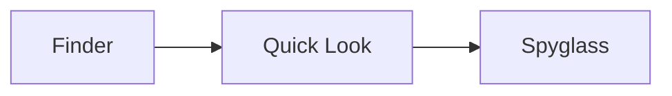

# Spyglass sample

A **Markdown** file with `inline code`, a [link](https://example.com), and a table.

| Format | Renderer |
|---|---|
| Markdown | web |
| TSV | native |

- [x] task list item
- [ ] another one

Inline math $e^{i\pi} + 1 = 0$ and a block:

$$\int_0^1 x^2\,dx = \tfrac{1}{3}$$

```swift
let greeting = "Hello"
print(greeting)
```



> [!NOTE]
> GitHub-style alert.
